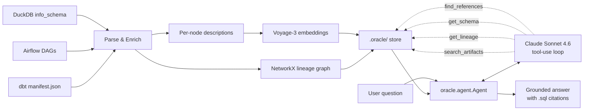

# Lineage Oracle


An AI agent that answers questions about a data warehouse with grounded lineage citations.

> *"What feeds `fct_user_metrics`?"* → traces upstream models with their source DAGs, citing each `.sql` file.

## Demo


*A 15-30 second Streamlit clip lives at `docs/demo.gif`. Record with QuickTime or `asciinema` + `agg` and drop it in.*

## What it does

Lineage Oracle ingests a dbt project's `manifest.json`, the Airflow DAG files that refresh raw tables, and a DuckDB warehouse's `information_schema`. It builds a NetworkX lineage graph and a Voyage-3 embedding index over each artifact, then answers questions via a Claude tool-use loop.

Four supported question types:

- **Lineage**: *"What feeds X?"* / *"What does X feed?"*
- **Impact**: *"If I drop column Y, what breaks?"*
- **Semantic**: *"Which table tracks user purchases?"*
- **Schema**: *"What columns are in X?"*

Every answer is grounded: the agent cites the `.sql` file or DAG it pulled each fact from, and is instructed to refuse rather than invent table or column names.

## Use Cases

- **Analyst onboarding**: a new hire asks *"what feeds `fct_orders`?"* and gets a citation-backed answer without pinging the data team.
- **Change impact review**: before dropping a column or renaming a model, ask *"if I drop `customer_id` from `stg_customers`, what breaks?"* and see every downstream reference.
- **Semantic model discovery**: *"which table tracks refunds?"* across hundreds of dbt models, ranked by embedding similarity plus lineage centrality.
- **On-call and incident response**: when a dashboard goes red, trace it back to the upstream source in one question instead of five Slack pings.

## Architecture



Two-phase system:

- **Index Phase** (`oracle index`): parses the inputs, builds the lineage graph, generates per-node descriptions, embeds them with Voyage-3, persists everything to `.oracle/`.
- **Query Phase** (`oracle ask "..."`): loads the graph + vector store, runs a Claude Sonnet 4.6 tool-use loop with four tools: `search_artifacts`, `get_lineage`, `get_schema`, `find_references`.

The `oracle` Python library is the single source of truth; the CLI and the Streamlit chat UI are thin wrappers over `oracle.agent.Agent`.

## One-command demo

After cloning and setting your API keys in `.env`:

```bash
make demo
```

This seeds the jaffle-shop DuckDB warehouse, runs `dbt parse`, indexes the project, and drops you into the Streamlit chat UI. See `Makefile` for the underlying steps.

## Quickstart (manual)

```bash
# 1. Install
uv sync

# 2. Configure API keys
cp .env.example .env
# Edit .env to add ANTHROPIC_API_KEY and VOYAGE_API_KEY

# 3. Build the demo warehouse + manifest
cd data/jaffle_shop/dbt_project
dbt seed && dbt run && dbt parse
cd ../../..

# 4. Index
uv run oracle index \
  --manifest data/jaffle_shop/dbt_project/target/manifest.json \
  --dags-dir data/jaffle_shop/dags \
  --warehouse data/jaffle_shop/dbt_project/jaffle_shop.duckdb

# 5. Ask
uv run oracle ask "what feeds fct_orders?" \
  --warehouse data/jaffle_shop/dbt_project/jaffle_shop.duckdb \
  --search-dir data/jaffle_shop

# 6. Or use the chat UI
uv run streamlit run ui/streamlit_app.py
```

## Eval results

A pytest-based eval harness at `evals/` measures fact recall, citation precision, and no-invention rate against ~30 ground-truth questions.

```bash
uv run pytest evals/ -v
```

(Skipped automatically when API keys aren't set.)

## Tech stack

- **LLM:** Claude Sonnet 4.6 (Anthropic SDK, native tool use, no LangChain)
- **Embeddings:** Voyage-3
- **Vector store:** DuckDB + VSS extension
- **Lineage graph:** NetworkX, persisted as JSON
- **dbt parsing:** `manifest.json` (no dbt runtime)
- **Airflow parsing:** Python `ast` (static)
- **CLI:** Typer
- **UI:** Streamlit
- **Test framework:** pytest

## Documentation

- [`docs/ARCHITECTURE.md`](docs/ARCHITECTURE.md): system architecture, components, key design decisions
- [`docs/EVALS.md`](docs/EVALS.md): eval harness format, metrics, and how to run
- [`docs/superpowers/specs/2026-05-06-lineage-oracle-design.md`](docs/superpowers/specs/2026-05-06-lineage-oracle-design.md): full design spec
- [`docs/superpowers/plans/2026-05-06-lineage-oracle.md`](docs/superpowers/plans/2026-05-06-lineage-oracle.md): 24-task implementation plan

---

**Part of my Data + AI Reliability suite:**
[lineage-oracle](https://github.com/Mona-Alkhatib/lineage-oracle) · [dbt-sentinel](https://github.com/Mona-Alkhatib/dbt-sentinel) · [dq-test-generator](https://github.com/Mona-Alkhatib/dq-test-generator) · [dq-watchdog](https://github.com/Mona-Alkhatib/dq-watchdog)

If Lineage Oracle helps your data workflows, please give it a ⭐ so more data teams can find it.
